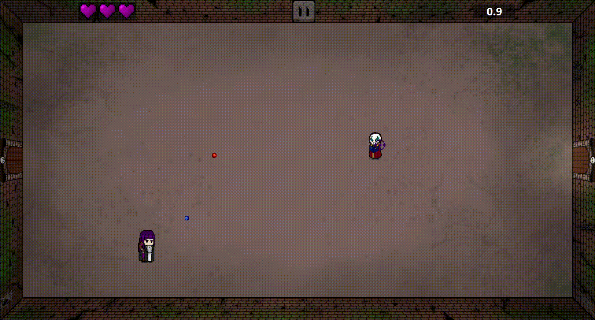

# Violet Descent

A 2D top-down dungeon crawler game built entirely in Java using the JavaFX framework. Players navigate through procedurally populated rooms, battle waves of enemies, and compete for the highest score. 

## Tech Stack
* **Language:** Java
* **Framework:** JavaFX (FXML & CSS for UI layouts and styling)
* **Database:** MySQL (JDBC)
* **Architecture:** Object-Oriented Programming (OOP)

## Key Features

* **Custom Game Loop & Physics:** Implemented a continuous game loop using `AnimationTimer` with custom delta-time calculations. Features custom bounding-box collision detection for entities, projectiles, and environmental walls.
* **State-Driven Entities:** Utilized interfaces and abstract classes (`Entity`, `DynamicEntity`, `Character`) to manage player and enemy states, including movement, health, attack cooldowns, and knockback mechanics.
* **Dynamic Spawning:** Algorithmically generates enemy waves based on the current level, ensuring enemies do not overlap with each other or the player upon spawning.
* **Persistent Database Integration:** Connected to a local MySQL database to handle saving/loading game states (health, level, elapsed time) and a persistent global leaderboard.
* **Custom UI & Audio:** Designed interactive menus, HUDs, and pause screens using FXML and CSS. Integrated JavaFX `AudioClip` and `MediaPlayer` for dynamic sound effects and background music.

## How to Run

1. Clone this repository.
2. Set up a local MySQL database named `violet_descent_game` and configure the credentials in `DBConnection.java`.
3. Ensure the JavaFX SDK is configured in your IDE (IntelliJ/Eclipse).
4. Run `Main.java` to start the application.

## Contributors

* **Yousuf Islam** - [fyseo](https://github.com/fyseo)
* **Abdulrehman-Hatem** - [Abdulrehman's GitHub](https://github.com/Abdulrehman-Hatem)
